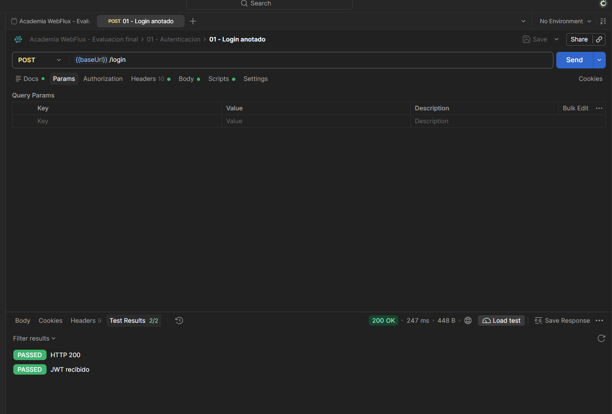
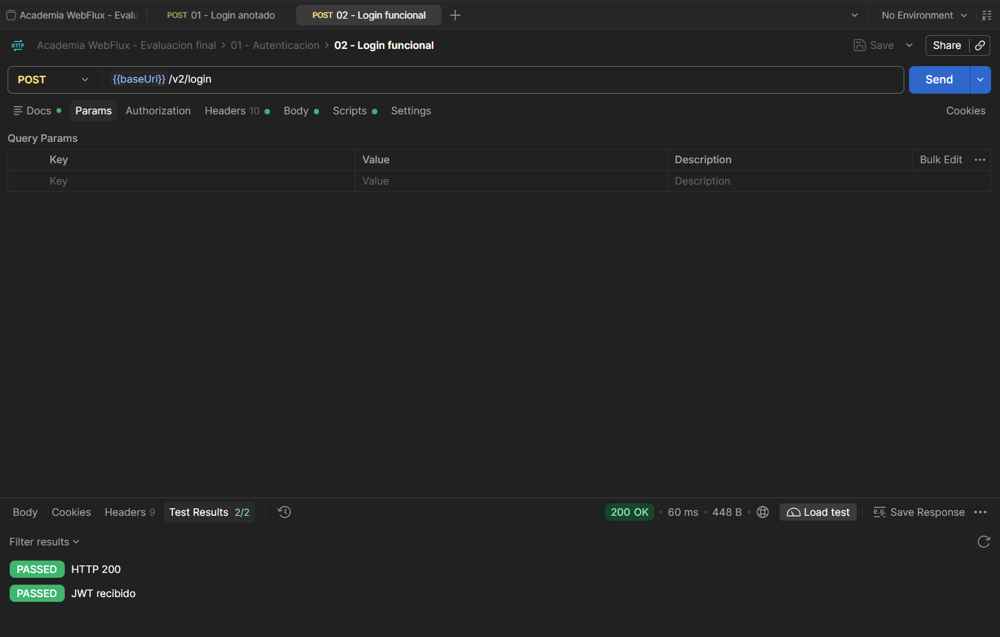
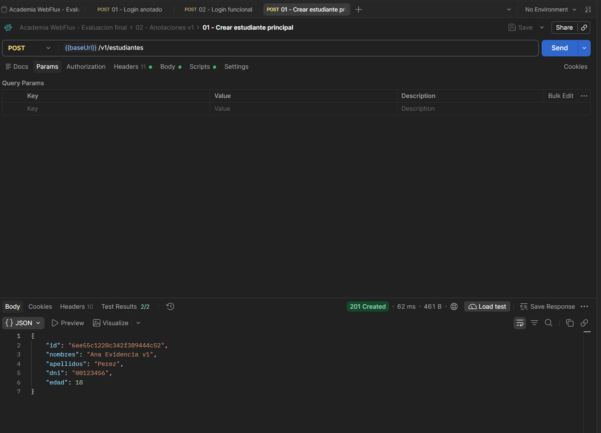
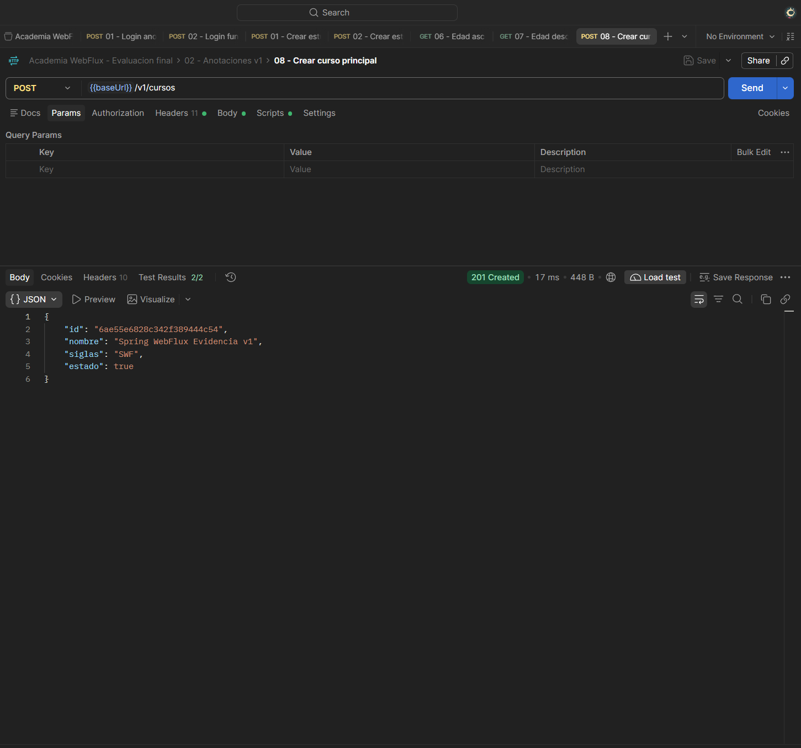
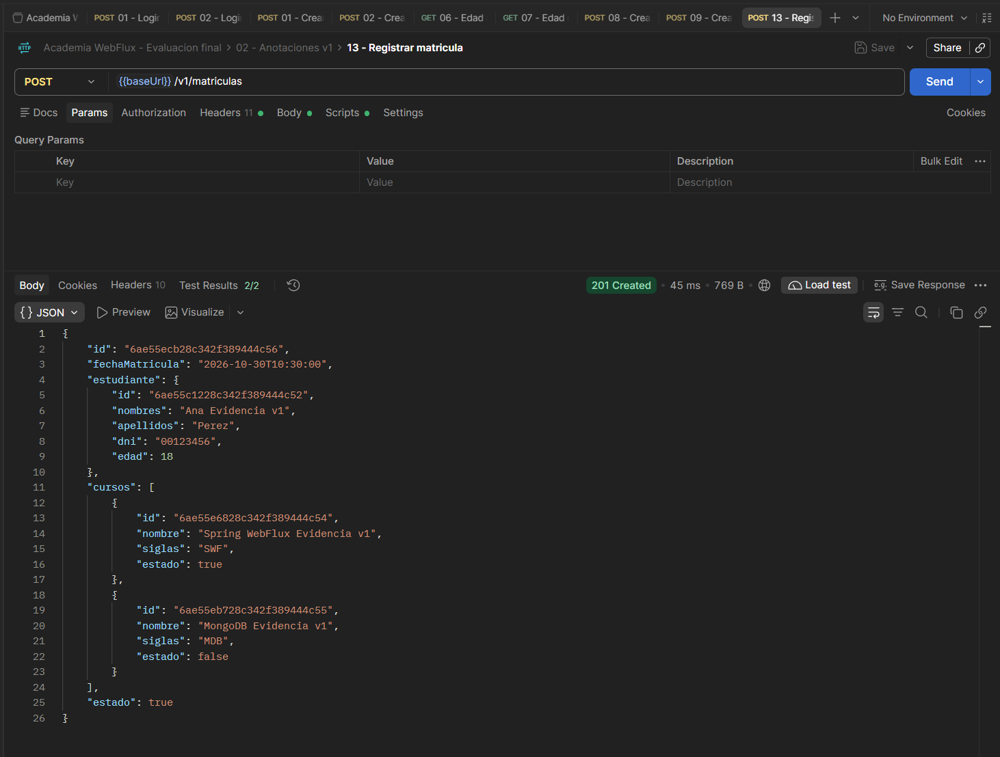
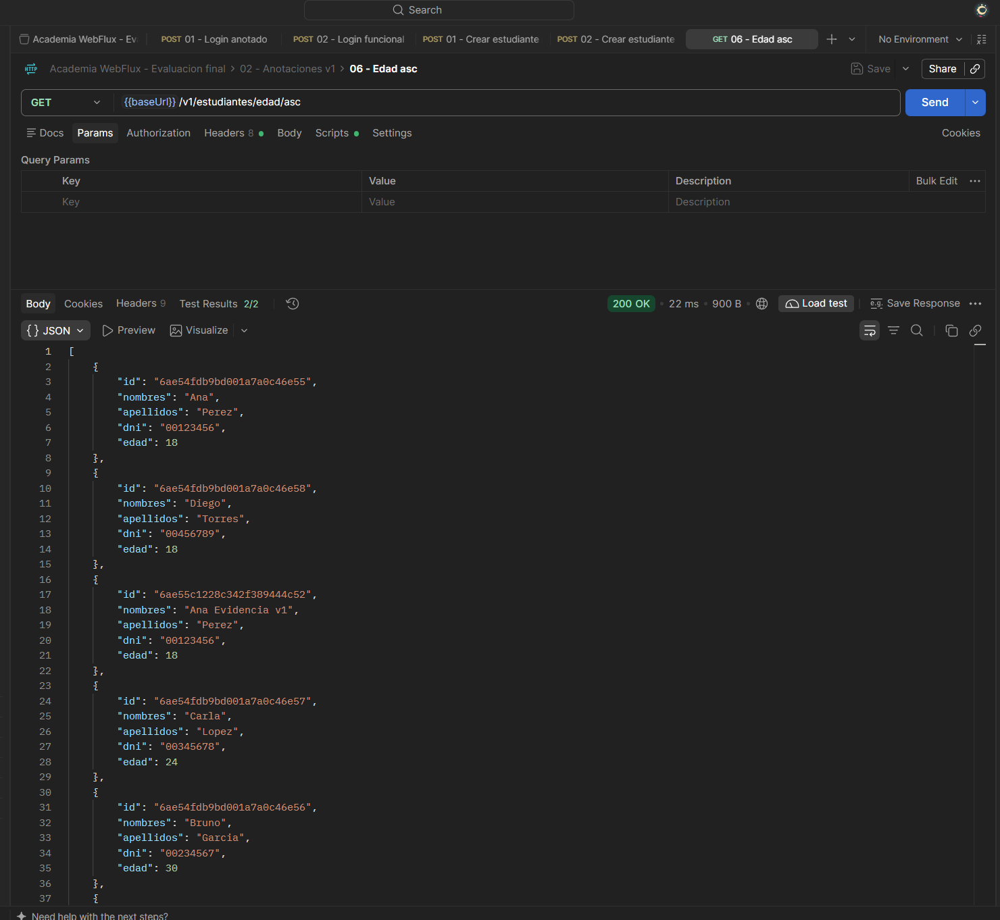
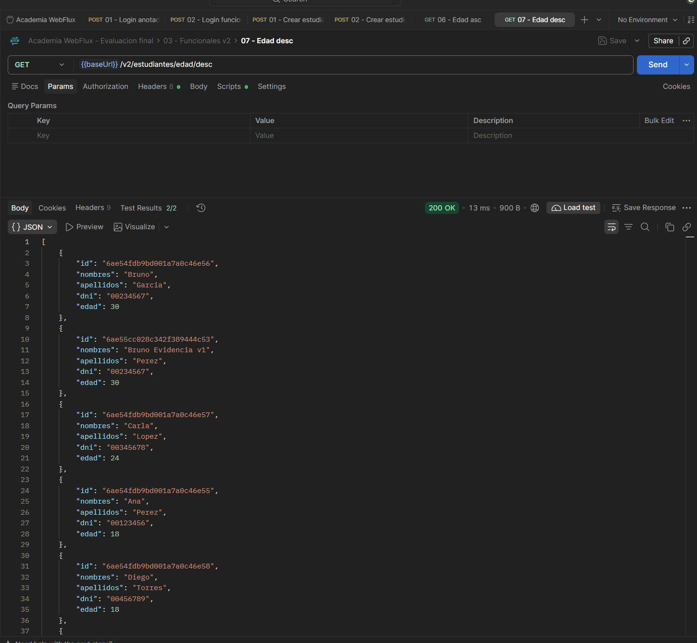
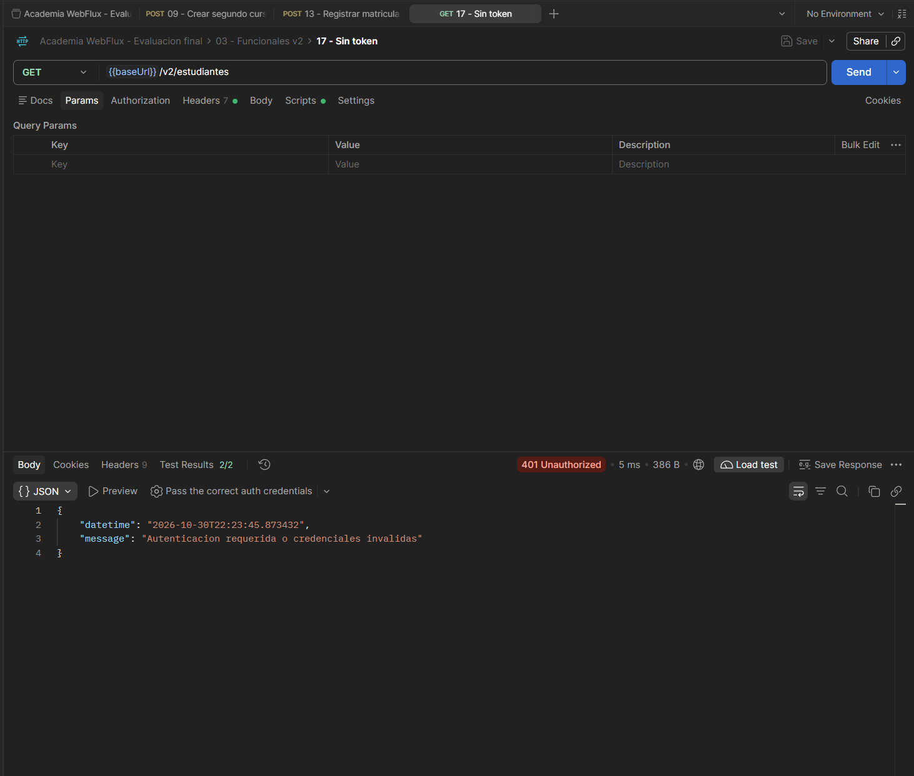

# Academia WebFlux

API reactiva para gestionar estudiantes, cursos y matrículas con Spring Boot, MongoDB y autenticación JWT.

## Estructura del proyecto

Paquete principal: `src/main/java/com/orlandini/academiawebflux`.

| Paquete | Responsabilidad |
| --- | --- |
| `model` | Documentos de estudiantes, cursos, matrículas, usuarios y roles. |
| `dto` | Datos de entrada y salida de la API. |
| `repo` | Repositorios reactivos de MongoDB e `IGenericRepo`. |
| `service` y `service/impl` | Lógica de negocio, `ICRUD`, `CRUDImpl`, matrículas y orden por edad. |
| `controller` | Endpoints con anotaciones bajo `/v1`. |
| `handler` | Handlers de los endpoints funcionales bajo `/v2`. |
| `config` | Rutas funcionales, ModelMapper y configuración inicial. |
| `security` | Login, BCrypt, validación JWT y protección de rutas. |
| `validator` y `exception` | Validación de entradas y respuestas globales de error. |

Otros directorios:

- `src/test`: pruebas de componentes e integración.
- `.agents`: especificaciones, cuatro definiciones de agentes y tres workflows.
- `docs`: contrato de la API, cumplimiento y capturas de Postman.
- `scripts`: preparación del entorno, ejecución y verificaciones.

Los controladores y handlers comparten servicios; estos acceden a MongoDB mediante los repositorios reactivos.

## Evaluación final

### Modelos

| Documento | Campos |
| --- | --- |
| `Estudiante` | `id`, `nombres`, `apellidos`, `dni` como String; `edad` como int. |
| `Curso` | `id`, `nombre`, `siglas` como String; `estado` como boolean. |
| `Matricula` | `id` String, `fechaMatricula` LocalDateTime, `estudiante` Estudiante, `cursos` List de Curso y `estado` boolean. |

La matrícula se guarda como un único documento con los datos completos del estudiante y los cursos.

### Servicios requeridos

Todas las operaciones están disponibles tanto en `/v1` (anotaciones) como en `/v2` (funcionales):

| Funcionalidad | Ruta sin prefijo |
| --- | --- |
| CRUD de estudiantes | `GET/POST /estudiantes`; `GET/PUT/DELETE /estudiantes/{id}` |
| CRUD de cursos | `GET/POST /cursos`; `GET/PUT/DELETE /cursos/{id}` |
| Registrar matrícula | `POST /matriculas` |
| Edad ascendente | `GET /estudiantes/edad/asc` |
| Edad descendente | `GET /estudiantes/edad/desc` |

Se cubren las **13 operaciones de negocio en ambos estilos**. También se incluye `GET /matriculas/{id}` para consultar el documento registrado.

### Requisitos técnicos

- **Spring Boot 4.1.2** y MongoDB reactivo.
- **Spring Security + JWT**: firma y expiración verificadas para acceder a los endpoints de negocio.
- Colecciones `users` (`id`, `username`, `password`, `status`, `roles`) y `roles` (`id`, `name`), con contraseñas BCrypt.
- Errores globales con `datetime` y `message`; validación mediante Jakarta Validation y `RequestValidator`.
- Especificaciones, agentes y workflows en `.agents`.
- Repositorio público y `.gitignore` para excluir compilados, configuración privada y archivos del IDE.

El [detalle de cumplimiento](docs/CUMPLIMIENTO.md) relaciona cada requisito con sus archivos y verificaciones.

## Ejecución

Requiere **Java 25**, MongoDB activo en `localhost:27017` e internet para descargar dependencias la primera vez. Desde la raíz del proyecto, en PowerShell:

```powershell
powershell -NoProfile -ExecutionPolicy Bypass -File .\scripts\preparar-local.ps1
powershell -NoProfile -ExecutionPolicy Bypass -File .\scripts\verificar.ps1 -Mode verify
powershell -NoProfile -ExecutionPolicy Bypass -File .\scripts\iniciar.ps1
```

API: `http://localhost:8080`. Las credenciales se generan en `.local/ACCESO.txt` y quedan excluidas de Git.

En IntelliJ: abrir `pom.xml`, recargar Maven, seleccionar JDK 25 y ejecutar `AcademiaWebfluxApplication` desde la raíz. Usar una sola instancia en el puerto 8080.

## Postman y pruebas

Importar [Academia.postman_collection.json](docs/postman/Academia.postman_collection.json), completar la variable `password` con la contraseña local y ejecutar `POST /login` o `POST /v2/login`. La colección guarda el token para las peticiones protegidas, que usan `Authorization: Bearer <token>`.

**41 pruebas aprobadas**: 27 de integración y 14 de componentes, sin fallos, errores ni casos omitidos. Comprueban CRUD en ambos estilos, matrículas, edades, validación y seguridad. Ver [resultados de verificación](docs/VERIFICACION.md).

## Evidencias de Postman

### Login con anotaciones

`POST /login` → **200 OK**, 2/2 comprobaciones aprobadas.



### Login funcional

`POST /v2/login` → **200 OK**, 2/2 comprobaciones aprobadas.



### Crear estudiante

`POST /v1/estudiantes` → **201 Created**, con ID generado y datos completos.



### Crear curso

`POST /v1/cursos` → **201 Created**, con nombre, siglas y estado.



### Registrar matrícula

`POST /v1/matriculas` → **201 Created**, con fecha, estudiante, dos cursos y estado.



### Edad ascendente

`GET /v1/estudiantes/edad/asc` → **200 OK**, de menor a mayor edad.



### Edad descendente

`GET /v2/estudiantes/edad/desc` → **200 OK**, de mayor a menor edad.



### Acceso sin token

`GET /v2/estudiantes` sin autenticación → **401 Unauthorized**.



## Documentación

- [Contrato de la API](docs/API.md).
- [Cumplimiento de requisitos](docs/CUMPLIMIENTO.md).
- [Variables de configuración](.env.example).
- [Especificación de academia](.agents/features/academia/spec.md) y [seguridad](.agents/features/security/spec.md).
- [Agentes](.agents/subagents) y [workflows](.agents/workflows).
